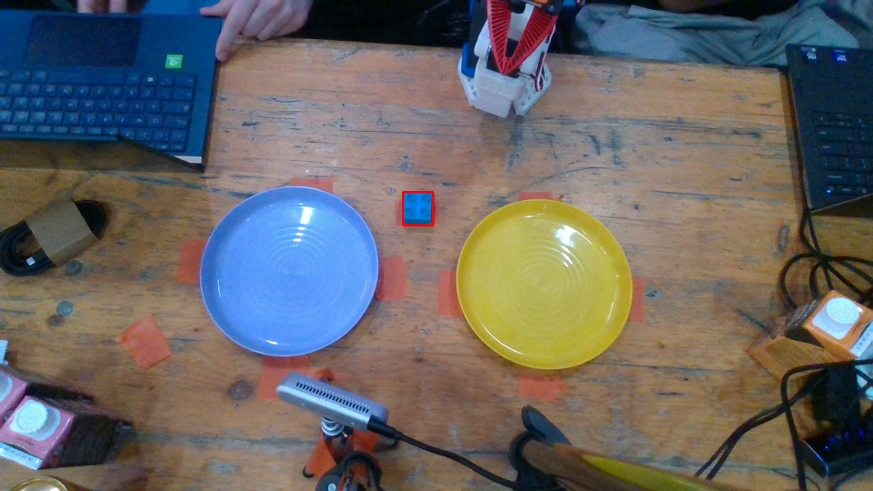

# Byte Vinci: SO-101 Brick Sorting Station (Junction 2026, Intel Physical AI Challenge)

The project of team **Byte Vinci** for the **Intel Physical AI Challenge** at **Junction 2026**: a robotic station in which an
SO-101 arm picks Duplo bricks, inspects them with cameras and decides with anomaly detection (Anomalib) whether a
pen-drawn cross, the "defect", is on the brick, so that defective bricks can be sorted from good ones.

## Demo

▶️ **[Watch the demo on YouTube](https://www.youtube.com/watch?v=fDdRyTmyP8A)**: the full closed loop on the real
SO-101 arm, with both a defective brick and a good one.

In the demo the station:

- picks the brick chosen by the user from a plate holding **several Duplo bricks of different colours and shapes**;
- shows it to the inspection camera and runs the anomaly detection;
- **re-grips the brick**: it sets the brick down on the table, turns it and grips it again, then shows the camera the
  faces that were hidden under the gripper fingers, so that even a small defect that was covered at the first grasp
  is found;
- sorts the brick as good or defective.

## About Junction

[Junction](https://www.hackjunction.com) is one of Europe's largest hackathons, held every year in Finland. Over a
weekend, teams of students, developers and designers build working prototypes for challenges set by partner
companies, and present them to the company judges at the end of the event.

## The challenge

The **Intel Physical AI Challenge** (Intel x Ignite Next), *"See It. Detect It. Act on It."*, asked teams to build an
end-to-end Physical AI solution for robotic defect detection and manipulation on Intel hardware:

| Step | What it means |
|---|---|
| **Perceive** | Capture images of the objects in the robot's workspace |
| **Detect** | Use Anomalib to separate acceptable ("perfect") objects from anomalous ("defective") ones |
| **Reason** | Use Intel Physical AI Studio and a Vision-Language-Action / imitation-learning policy to decide the action |
| **Act** | Have the SO-101 arm pick and sort the objects |
| **Optimize** | Deploy with OpenVINO on an Intel Core Ultra Series 3 AI PC, using its CPU, GPU and NPU |

**Hardware:** SO-101 leader/follower arm pair, two Intel RealSense D415 depth cameras and a wrist camera, and an
Intel Core Ultra X9 388H AI PC running Ubuntu 26.04.

**Software:** Intel Physical AI Studio (LeRobot-based imitation learning, ACT and SmolVLA policies), Anomalib 2.7,
OpenVINO, PyTorch on the Intel GPU (XPU), Python, FastAPI and OpenCV.

## What we built

- **A single web-based control tool for the station** (`anomaly_capture/`, served at `http://127.0.0.1:7870/arm`):
  arm setup and teleoperation, teaching and replaying waypoints, live views of the three cameras, and safety
  functions (STOP, rate limits, detection of a blocked arm).
- **Camera pipeline for inspection:** locked exposure and white balance, multi-frame averaging to reduce sensor
  noise in a dim room, brick detection against an empty-background reference, lossless crops and depth-based
  background masking, so that the images seen at run time match those used for training.
- **Data collection for imitation learning:** a human teleoperates the pick, the robot then carries the brick to a
  fixed waypoint automatically, and each run is recorded as one episode. An export step cleans the demonstrations
  (rejects failed attempts, trims pauses, smooths the motion) and writes a dataset that Physical AI Studio can use
  to train an **ACT** policy locally on the Intel GPU.
- **Anomaly detection design:** one-class models trained only on good images (**PatchCore** as the main model,
  **EfficientAd** as a fast model suited to the NPU), with defect images used only to set thresholds and to measure
  the smallest cross that is detected reliably.
- **Adaptive inspection cascade (our main idea):** a fast model clears the easy bricks, a more accurate
  high-resolution model handles the uncertain ones, and only the hardest cases trigger active perception, with the
  arm moving the wrist camera close to the brick. Compute is spent only where it is needed, and an uncertain brick is
  rejected for safety.
- **Re-grip station:** the arm sets the brick down, measures its position and orientation with the top camera and
  grips it again turned by 90°, so that the faces hidden under the gripper fingers can also be inspected. A defect
  that was covered by the fingers, or that sat on a face the camera could not see at first, is still detected.
- **User interface for task selection:** the operator chooses from the web page which brick the robot should pick,
  and the brick is identified by its colour with the top camera.
- **Robust to different bricks:** the station works with several Duplo bricks of different colours and shapes
  (2×2 and 2×4) lying together on the same plate.
- **Faster motion:** smooth acceleration and deceleration profiles on the arm's trajectories, so the robot moves
  faster without jerky starts and stops.

The full engineering log, with every decision, measurement, issue and fix, is in
[`SO101_SETUP_STATUS.md`](SO101_SETUP_STATUS.md).

## Team: Byte Vinci

- Luca Bottelli
- Omar Idrissi
- Taufge
- Andrea Cevenini ([LinkedIn](https://www.linkedin.com/in/andrea-cevenini-499754237))

The team's original working repository is
[`lucabottelli/junction-2026`](https://github.com/lucabottelli/junction-2026).

## Repository layout

| Path | What |
|---|---|
| `anomaly_capture/` | The control tool. One page at `http://127.0.0.1:7870/arm`: setup, teach waypoints, data collection, export to Studio, later phases |
| `anomaly_capture/capture.py` | Server and cameras (2× RealSense D415 + USB wrist camera), locked exposure and white balance |
| `anomaly_capture/arm.py` | Follower/leader control, teach and replay waypoints, safety (STOP, rate limits, blocked detection) |
| `anomaly_capture/collect.py` | Phase 1 (teleoperated pick + automatic carry to WP1, recorded for ACT) and phase 2 (WP2 front-camera images) |
| `anomaly_capture/regrip.py` | Re-grip station: set the brick down, measure it with the top camera, grip it again turned 90° or further along |
| `anomaly_capture/export_act.py` | Cleans the raw demonstrations and writes a Physical AI Studio / LeRobot dataset |
| `anomaly_capture/prep.py` | Image preprocessing shared by collection, export and run time (crops, depth background mask) |
| `anomaly_capture/ui.py` | The single web page |
| `anomaly_capture/cam_settings.json`, `routines.json` | Locked camera settings and taught waypoints (station-specific) |
| `scripts/` | Small hardware helper scripts |
| `report_images/` | Images for the report |

## Run (on the station PC)

Needs Intel Physical AI Studio installed at `~/physical-ai-studio` (its Python environment provides lerobot,
pyrealsense2, OpenCV and FastAPI). Close Studio's Environment view (the cameras and arms are exclusive) and keep its
backend running.

    ~/junction26/anomaly_capture/restart.sh      # then open http://127.0.0.1:7870/arm

Station-specific values (arm serials, camera serials, wrist camera device) are constants at the top of
`capture.py` and `arm.py`.

## Data (not in the repository)

`training_images/` (anomaly images) and `episodes/` (raw pick demonstrations) are created by the tool and are too
large for git. Copy them separately or publish them as a Hugging Face dataset.
